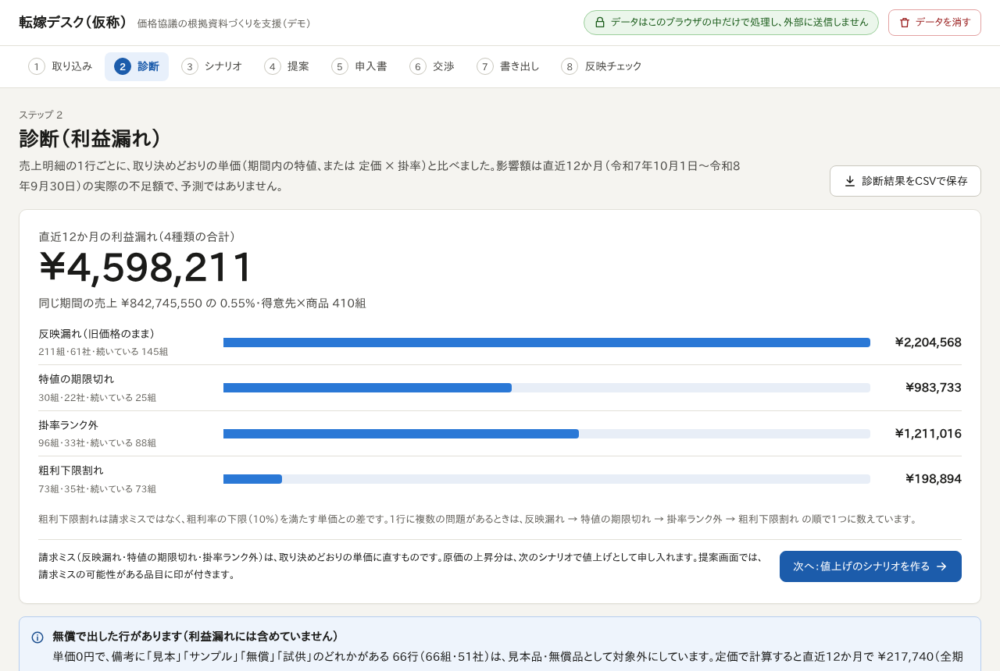
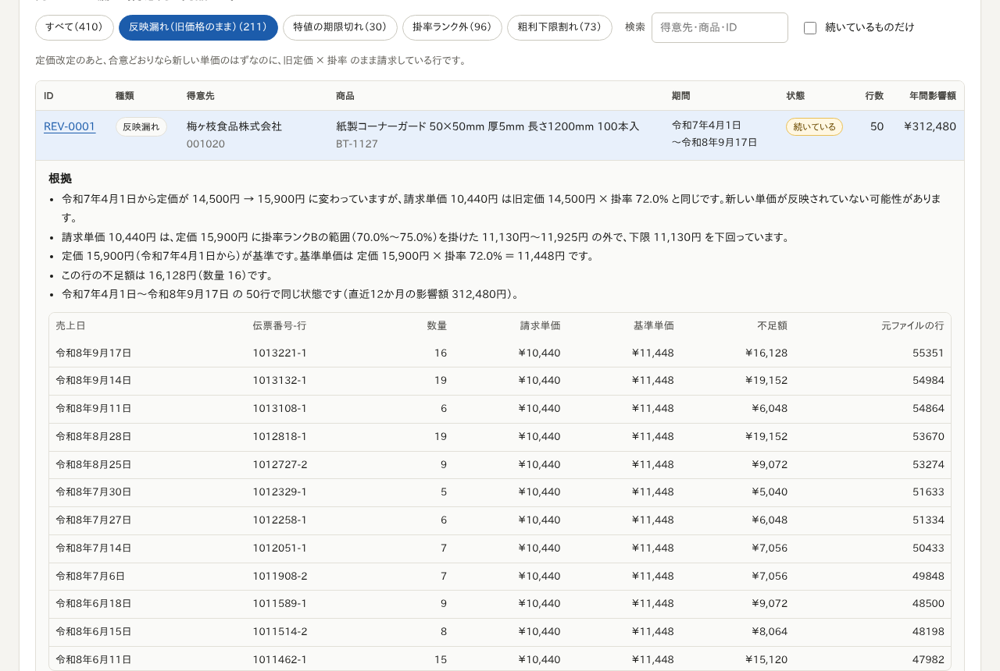
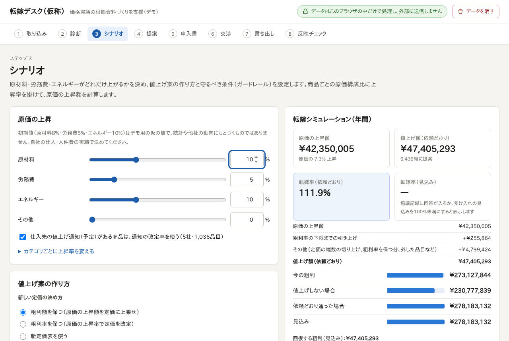
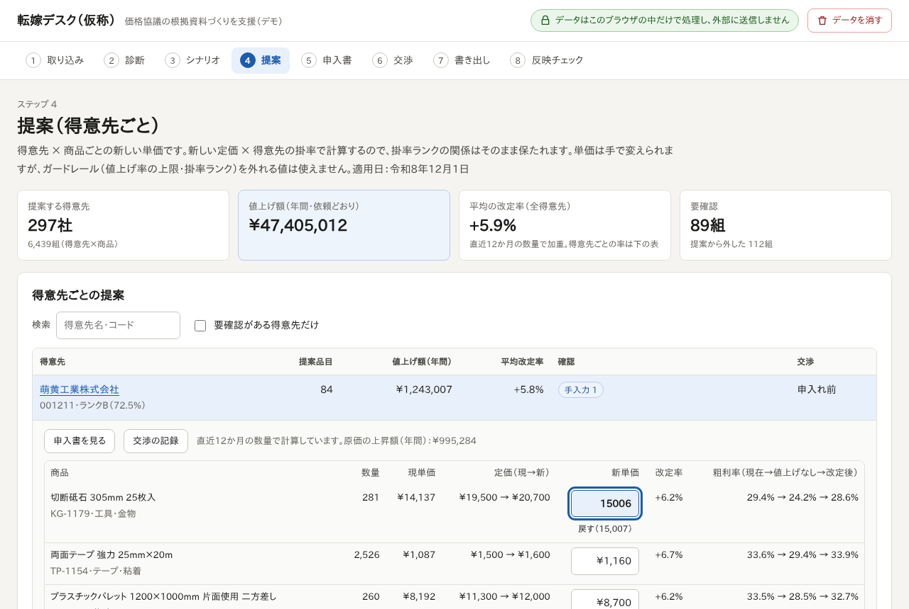
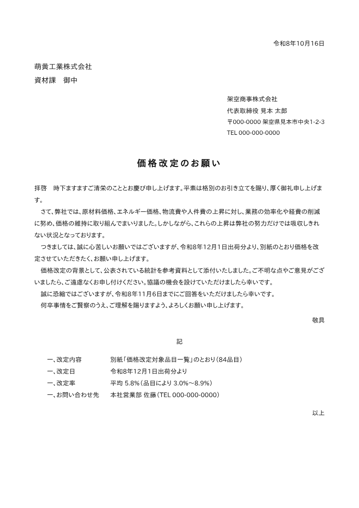
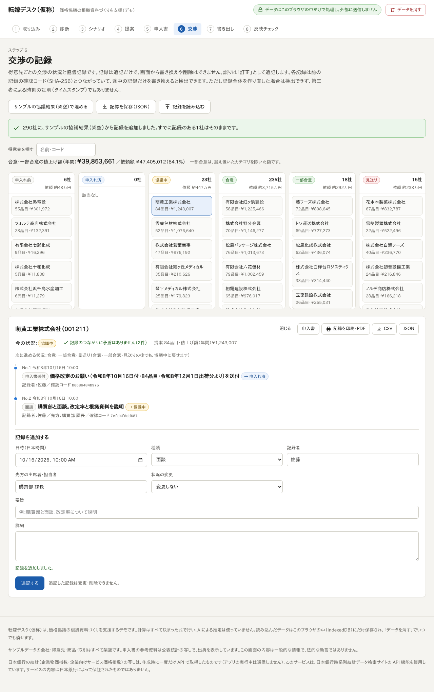
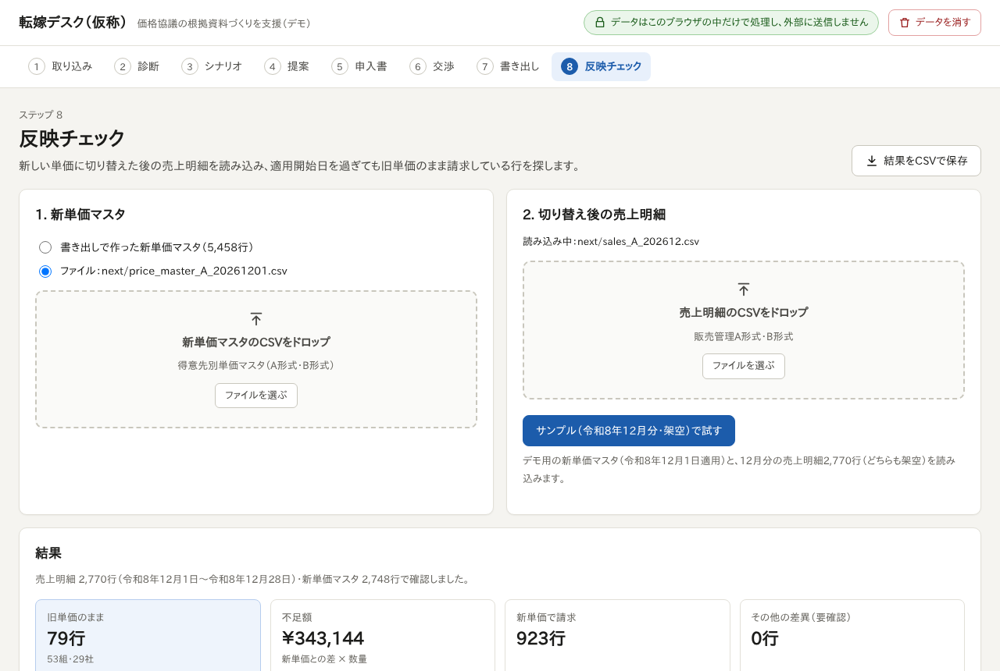

# 転嫁デスク（仮称）

**価格協議の根拠資料づくりを支援する**Webアプリのデモです。得意先が数百社・商品が数千点ある中堅の卸売・商社・B2Bメーカーを想定しています。

販売管理システムから書き出した売上明細を読み込み、取り決めどおりに請求できていない「利益漏れ」を見つけ、原価の上昇に合わせた値上げ案と得意先ごとの申入書を作り、交渉の記録を残し、新しい単価マスタを書き出して、切り替え後の請求に反映されたかを確かめるところまでを、ブラウザの中だけで行います。

> English: [README.en.md](README.en.md)

> **サンプルデータはすべて架空です。** 会社名（架空商事株式会社）・得意先名・商品・価格・取引は作り物で、実在の企業・団体・人物・取引とは関係ありません。申入書の参考資料に使う公表統計（日本銀行・厚生労働省）だけは実在の統計の写しで、出典を表示しています。



## できること

| | 画面 | 内容 |
|---|---|---|
| 1 | 取り込み | CSV をドラッグ＆ドロップ（または「サンプルデータで試す」）。UTF-8 / Shift_JIS、全角・半角、和暦、品番の書きゆれ（`ＤＢ－１００１`・`db-1001`・`DBー1001`）をそろえます。列の見出しから種類を判別し、判別できないファイルは列の対応を画面で指定できます。足りないファイルと、その影響を表示します。 |
| 2 | 診断 | 1行ごとに取り決めどおりの単価（期間内の特値、または 定価 × 掛率）と比べ、**反映漏れ**（改定後も旧価格のまま）・**特値の期限切れ**・**掛率ランク外**・**粗利下限割れ**を見つけます。最初に直近12か月の影響額（円）を種類別に示し、得意先×商品ごとの一覧から、根拠の文章と該当する売上明細までたどれます。得意先単位で起きている可能性があるもの（得意先マスタの誤りなど）もまとめて示します。 |
| 3 | シナリオ | 原材料・労務費・エネルギー・その他の上昇率をスライダーで決めます。商品ごとの原価構成比に掛けて原価の上昇額を出し、仕入先の値上げ通知がある商品は通知の率を使えます。ガードレール（値上げ率の上限、最小値上げ率、粗利率の下限、特値の扱い、定価の端数処理）を設定し、転嫁率と回復する粗利をシミュレーションします。 |
| 4 | 提案 | 得意先 × 商品ごとの新単価。新定価 × 得意先の掛率で計算するので、掛率ランクの関係が崩れません。単価は手で変えられますが、現単価より下・値上げ率の上限超え・掛率ランク外になる値は使えません（粗利率の下限を割る値は警告つきで使えます）。 |
| 5 | 申入書 | 得意先ごとの「価格改定のお願い」。和暦の日付、拝啓〜敬具、記〜以上、別紙の対象品目一覧、公表統計のグラフつき参考資料。ブラウザの印刷で A4 の PDF にできます（ページ番号つき。別紙・参考資料は各ページに名前が入り、サンプルデータでは全ページに「サンプル（架空データ）」と入ります）。本文の段落は書き換えられ、送る前の確認項目を表示します。自社の原価の内訳は載せません。 |
| 6 | 交渉 | 状況ごとのカンバン（申入れ前 → 申入れ済 → 協議中 → 合意／一部合意／見送り）と、得意先ごとの協議記録。記録は画面からは**追記だけ**で、書き換え・削除はできません（誤りは「訂正」として追記）。各記録は前の記録の SHA-256 とつながっていて、途中の記録だけを書き換えると検出できます。記録全体を作り直されると検出できず、第三者のタイムスタンプでもないことを、画面と印刷にも書いています。印刷（PDF）・CSV・JSON で保存できます。 |
| 7 | 書き出し | 合意した得意先の新単価を、適用開始日つきの単価マスタとして販売管理A形式・B形式の CSV（UTF-8 / Shift_JIS）で保存します。 |
| 8 | 反映チェック | 切り替え後の売上明細を読み込み、適用開始日を過ぎても旧単価のまま請求している行を見つけます。 |

## デモの流れ（サンプルデータ・架空）

1. 「取り込み」で **サンプルデータで試す（A形式）** を押します。得意先300社・商品2,000点・売上明細56,328行（令和6年10月〜令和8年9月）を読み込み、診断まで約3秒です（開発環境のヘッドレス Chromium で計測）。読み込みが終わると、そのまま「診断」の画面に進みます。
2. 「診断」：直近12か月の利益漏れは **¥4,598,211**（反映漏れ ¥2,204,568／特値の期限切れ ¥983,733／掛率ランク外 ¥1,211,016／粗利下限割れ ¥198,894）。得意先まるごと起きている4社も示します。
   
3. 「シナリオ」：原材料・労務費・エネルギーの上昇率とガードレールを決めます。初期設定（原材料8%・労務費5%・エネルギー10%、仕入先の値上げ通知を使う、上限20%）では、転嫁率（依頼どおり）が約112%です。
   
4. 「提案」：得意先ごとの値上げ額と、品目ごとの新単価を確認・修正します。
   
5. 「申入書」：得意先を選んで内容を確認し、印刷して PDF にします。「協議記録に『申入書送付』を記録」で交渉の記録につなげます。
   
6. 「交渉」：**サンプルの協議結果（架空）で埋める** で、デモ用の回答（合意・一部合意・見送り・協議中）を記録に入れられます。面談や電話の記録を追記します。
   
7. 「書き出し」：合意・一部合意の得意先の新単価マスタを A形式・B形式で保存します。
8. 「反映チェック」：**サンプル（令和8年12月分・架空）で試す** で、旧単価のままの請求 **79行（53組・29社）、不足額 ¥343,144** が見つかります。
   

画面の画像はすべて `npm run e2e` が `docs/screenshots/` に保存したものです。

## 動かし方

Node.js 22.18 以上が必要です。

```bash
npm install
npm run sample     # 架空のサンプルデータを public/sample/ に作る（約30MB。リポジトリには入っていません）
npm run dev        # 開発用サーバー
```

| コマンド | 内容 |
|---|---|
| `npm run build` | 型チェックのあと `dist/` に書き出します。相対パス（`base: './'`）なので、どのフォルダ・サブパスに置いても静的ファイルとして動きます。サンプルデータを作ってからビルドすると `dist/sample/` に入ります。 |
| `npm test` | 単体テスト（Vitest）。エンジンと画面側のロジック、手書きの崩れたサンプル（`scripts/messy-sample/`）、言葉づかいと文書のそろい具合の確認、ブラインド検証の反映チェックの採点で 387件 |
| `npm run lint` / `npm run typecheck` | Biome / TypeScript |
| `npm run e2e` | ビルドして、Playwright でデモの流れを通しで確かめ、画面の画像を `docs/screenshots/` に保存します。`dist/` を `/tenka-desk/` というサブパスで配信して確かめます。サンプルデータと、Playwright 用の Chromium が必要です（未導入なら `npx playwright install chromium`）。 |
| `npm run evaluate` | 漏れ検出をサンプルデータの正解と比べます（[docs/evaluation.md](docs/evaluation.md)）。 |

## データとプライバシー

- **読み込んだデータは、すべてこのブラウザの中で処理します。** サーバーはなく、ファイルの中身を外部に送る処理はありません。画面にもそう表示しています。
- ビルドしたページには Content Security Policy（`connect-src 'self'` など）を入れていて、ブラウザ自身が、ページと同じ場所以外への通信を止めます。読み込むのは、アプリと同じ場所にある静的ファイル（画面・サンプルデータ・公表統計のスナップショット）だけです。Webフォント、アクセス解析、外部の CDN は使っていません。E2E テストでも、ほかのサイトへの通信が1件もないことを確かめています。
- 保存先はこのブラウザの IndexedDB です（読み込んだファイル、設定、手入力の単価、協議記録）。画面右上の **データを消す** で、いつでもすべて消せます。サンプルデータは保存せず、開くたびに読み直します。協議記録・協議結果ファイル・反映チェックの入力は、サンプル（架空）と自社データで別々に保存するので、サンプルで記録した「合意」が同じ得意先コードの自社の得意先に付くことはありません。
- 自社1社のデータだけを扱う前提です。他社の価格データを読み込んだり、他社と比べたりする機能はありません（独占禁止法上の配慮）。
- 書き出すファイル（CSV・JSON）もブラウザの中で作り、そのまま保存します。

## 計算の考え方

- **計算はすべて決まった式で行い、LLM（生成AI）は使っていません。** 金額は円・原価は銭（1/100円）・掛率は0.1%単位・率は0.01%単位の整数で計算し、割り算の端数処理はすべて明示しています。同じ入力からは、いつ・どこで計算しても同じ結果になります。
- **診断**：正しい単価は「期間内の特値、なければ 定価 × 掛率（円未満切り捨て）」。定価は、前回改定の合意状況（適用日の後ろ倒し・一部カテゴリ据え置き・見送り）を反映した、その得意先に適用すべき定価です（合意状況のファイルが使われているとき。次の章）。返品と運賃（商品マスタにないコード）は対象外です。単価0円で、備考に「見本」「サンプル」「無償」「試供」のどれかがある行は、無償品（見本品を含む）として対象外にし、利益漏れとは別に、行数と定価で計算した金額を診断の画面に示します。0円でも備考にこれらの言葉がない行は、ほかの行と同じに判定します。正しい単価より高い請求は利益漏れに数えず、「基準より高い請求（要確認）」として別に数えます（ただし粗利率が下限未満なら粗利下限割れに数えます）。1行に複数の問題があるときは、反映漏れ → 特値の期限切れ → 掛率ランク外 → 粗利下限割れ の順で1つに数えます。年間影響額は**直近12か月の実際の不足額**で、予測ではありません。
- **シナリオ**：商品の原単価 × 原価構成比 × 上昇率 を構成要素ごとに足します。仕入先の値上げ通知（予定）がある商品は、通知の改定率を使えます。
- **提案**：新しい定価の決め方は3つ。「粗利額を保つ」（初期設定。原価の上昇額を買い手の平均掛率で割り戻して定価に上乗せ）、「粗利率を保つ」（原価の上昇率で定価を改定）、「新定価表を使う」。定価は 1,000円未満は10円、1万円未満は50円、それ以上は100円単位にそろえます（変更可）。
- **転嫁率**＝値上げ額 ÷ 原価の上昇額。定価の切り上げや粗利率の下限までの引き上げを含むので、100%を超えることがあります。「粗利率を保つ」では、原価の上昇率と同じ率で定価を上げるため大きく超えます（サンプルの初期設定で、粗利額を保つ 約112%／粗利率を保つ 約159%／新定価表 約107%）。画面でも説明しています。数量は直近12か月と同じと仮定しています。
- **申入書**：参考資料は公表統計（国内企業物価指数・企業向けサービス価格指数・地域別最低賃金・春季賃上げ）のスナップショットで、出典と取得日を付けます。統計が出していない変化率は、申入書が自社の名前で出す文書なので「弊社算出」と書きます。取得日は日本時間の和暦で示し、下がった・横ばいの統計は入れません。最低賃金は、得意先ではなく自社（差出人）の都道府県を設定したときだけ引用します。本文の値上げの理由はシナリオで上がるとした費目から作り、段落ごとに書き換えられます。
- **協議記録**：各記録に、前の記録の SHA-256 を含めた確認コードを付けます。途中の記録を変えたり消したりすると、つながりの確認で分かります。ただし、記録全体を作り直されると分からないので、第三者による時刻の証明（タイムスタンプ）の代わりにはなりません。

## 自社のデータで使うとき：前回の改定日

「前回改定の合意状況」のファイル（以下、合意状況ファイル）には、得意先ごとに、前回の値上げ（定価改定）に合意したか・見送ったか・いつから新しい定価にするかが書いてあります。アプリは、このファイルが**どの定価改定の答えか**（改定日）が決まったときだけ、診断に使います。決まらないまま診断すると、値上げを見送った得意先や、適用日を後ろにずらした得意先の正しい旧価格まで「反映漏れ」に数えるので、反映漏れが多めに出ます。その旧価格から数量値引をした正しい行も「掛率ランク外」に数えるので、掛率ランク外も多めに出ます。

ここでいう**改定日**は、多くの商品（定価の履歴がある商品の5%以上、かつ10点以上）の定価が同じ日に変わった日です。アプリは定価の履歴から改定日を探します。

**アプリが改定日を自分で決めるとき**

1. 合意状況ファイルが1つで、定価の履歴の改定日も1つだけのとき：その日を使います（サンプルデータはこれです）。
2. 改定日が2つ以上あるとき：次の手がかりのどれかと合う改定日が**1つだけ**なら、その日を使います。
   - 合意状況ファイルの「適用日」で一番多い日付（一番多い日付が2つ以上あるときは手がかりにしません）
   - ファイル名の年月（例：`revision_2025-10_agreements.csv` なら2025年10月。`2025_10`・`202510`・`20251001` の書き方も読みます）。ファイル名に年月が2つ以上あるとき（`agreements_202504-202603.csv` のようなデータの期間）は、手がかりにしません
   - 設定ファイル（`demo_settings.json` など）の `previousRevisionDate`（合意状況ファイルが1つのときだけ使います）

   どの改定日とも合わないとき、手がかりが別々の改定日を指すとき、同じ月に改定日が2つあるときは、決めずに人に聞きます。

自分で決めたときは、取り込みと診断の画面に「〜の改定として扱いました」と、何から判断したかを出します。人が入れた改定日は、いつでもアプリの判断より優先します。アプリが決めた日は保存せず、読み込むたびに決め直します。

**前回の改定日を入れる手順**

1. 「取り込み」で、合意状況ファイルをほかのファイルと一緒に読み込みます。
2. アプリが改定日を決められないと、取り込み画面の上と診断の画面に「合意状況のファイルを使っていません。反映漏れが多めに出ています」という警告が出て、反映漏れ・特値の期限切れ・掛率ランク外の金額と合計、診断結果のCSVに「仮」が付きます（この3つは得意先ごとの取り決めの単価と比べるので、合意状況で変わります。粗利下限割れは原価と比べるので多めには出ず、仮にしません。ただし、反映漏れに数えた行の一部が、改定日を入れると粗利下限割れに移ることはあります）。シナリオから先の画面にも、現行単価と請求ミスの可能性の印が仮だという注意が出ます。申入書には、印刷にも「仮」と入り、「※ご請求」の注記は出しません。
3. 取り込み画面の下の「読み込みの確認」→「定価改定の合意状況」で、ファイルごとに前回の改定日（新しい定価が始まった日）を入れ、**この日付で計算し直す** を押します。定価の履歴にある改定日の候補が、そこに並んでいます。
4. 「令和…として使用中」と出れば、診断に使われています。入れた日に定価が変わった商品が1つもないときは「診断に使っていません」と出るので、日付を確かめてください。

## 判断が分かれる場面での読み方

文書だけでは答えが1つに決まらない場面で、アプリがどう判定するかです。協議中・見送り・適用日の後ろ倒しの読み方は、合意状況ファイルが診断に使われているとき（前の章）だけ効きます。使われていないと、これらの正しい旧価格も反映漏れに数えます。

| 場面 | アプリの読み方 |
|---|---|
| 合意状況が「協議中」 | 見送りと同じく、旧定価のままの請求を正しいとします。 |
| 合意状況に行がない得意先 | 改定に合意したものとみなします。新しい定価が正しく、旧定価のままの請求は反映漏れです。合意状況ファイルのない定価改定も、全得意先にこの扱いをします。 |
| 2回前の定価のままの請求 | 反映漏れにはしません。反映漏れは「その得意先に直前まで適用されていた定価のまま」の請求だけです。ランクの下限より安ければ掛率ランク外、ランクの範囲内なら原因不明の価格差です。 |
| 定価の値下げのあとも、前の高い定価で請求 | 利益漏れではなく「基準より高い請求（要確認）」です。漏れの件数と金額には入れません（粗利率が下限未満なら粗利下限割れに数えます）。 |
| 特値の期間が重なる | その日に有効な特値のうち、開始日が一番新しいものを使います。取り込み画面の「マスタの確認事項」に「特値の期間が重なっています」と出します。 |
| 数量値引の計算は合っているが、粗利率が下限を下回る | 粗利下限割れに数えます。不足額は（粗利率の下限を満たす単価 − 請求単価）× 数量です。 |
| 得意先マスタにない得意先（諸口・現金売上など） | 掛率がわからないので、対象外にします。 |
| 前回の改定を見送った得意先が、後の別の改定で定価が変わった商品を買った | 見送りは、合意状況ファイルの改定だけに効きます。後の改定に答えがなければ、後の改定の定価が正しい単価です。その直前にこの得意先に適用されていた定価（見送った改定より前の定価）のままなら反映漏れ、それ以外の古い単価は、ランクの下限より安ければ掛率ランク外、範囲内なら原因不明の価格差です。 |
| 改定のあとに出た商品 | 最初の定価がそのまま正しい単価です。前回の改定を見送った得意先でも同じです。 |
| 小数の値引率（例：「数量値引2.5%」） | 0.01%単位まで読みます。基準単価から値引した単価を、設定の単価の端数処理（初期設定は切り捨て）でそろえて請求単価と合えば、数量値引（正常）です。 |
| 単価0円の行 | 備考に「見本」「サンプル」「無償」「試供」のどれかがあれば、無償品として対象外にし、定価で計算した金額を別に示します。これらの言葉がなければ、ほかの行と同じに判定します（たいていは掛率ランク外で、不足額は 基準単価 × 数量）。 |

## 評価（自作の架空データでの結果）

詳しくは [docs/evaluation.md](docs/evaluation.md) にあります。**以下は、このプロジェクトで自作した架空データでの数字です。** サンプルデータとエンジンは、同じ文書（`data-gen/README.md`）の価格ルールにもとづいて作っていて、エンジンを書く前に正解の判定ルールを読んでいます。100%は「エンジンが文書化したルールどおりに動いている」ことの確認で、**実際の販売管理データでの精度を示すものではありません。**

| 漏れの種類 | 適合率（行） | 再現率（行） | 年間影響額（エンジン） | 年間影響額（正解） |
|---|---:|---:|---:|---:|
| 反映漏れ | 100.0% | 100.0% | 2,204,568円 | 2,204,568円 |
| 特値の期限切れ | 100.0% | 100.0% | 983,733円 | 983,733円 |
| 掛率ランク外 | 100.0% | 100.0% | 1,211,016円 | 1,211,016円 |
| 粗利下限割れ | 100.0% | 100.0% | 198,894円 | 198,894円 |

- 売上明細 56,328行（直近12か月：令和7年10月〜令和8年9月）。販売管理A形式とB形式で結果は1行も違いませんでした。
- 任意のファイルを外すと結果が大きく変わります。前回改定の合意状況がないと反映漏れの適合率は 44.4%、特値一覧がないと掛率ランク外の適合率は 11.2% に下がります。そのため取り込み画面と診断画面で、ファイルが足りないことと、その影響を表示しています。
- 反映チェック（令和8年12月分 2,770行）：旧単価のまま 79行を、取りこぼし・誤検出なしで見つけました（不足額 343,144円、正解と一致）。
- エンジンが書き出した新単価マスタ（A形式・B形式・Shift_JIS）を読み直して反映チェックをしても、同じ79行を見つけました。
- 生成したサンプルとは別に、手で書いた小さな「崩れた」サンプル（Shift_JIS、Excel の日付・数量、「合意に至らず」「未合意」、定価の値下げ、ランク上限を超える請求、原単価の列がない売上明細など18行）でも、判定は18行すべてで期待どおりでした。これも同じ人が書いたもので、独立した検証ではありません。
- 画面の E2E テストでも、診断の合計 ¥4,598,211 と反映チェックの 79行・¥343,144 を確かめています。

## 限界

- 実データでの精度はわかりません。価格改定が何度も重なる、銭単位の単価、後日の伝票で計上される値引・リベート、納品先別の単価、この2形式と大きく違う CSV など、サンプルにない状況がありえます。
- 判定はルールにもとづく機械的なものです。「漏れの可能性」を示すだけで、修正するかどうかは得意先との取り決めを確かめて人が判断します。
- 値上げ案と申入書は下書きです。送る前に必ず内容を確認してください。この画面の内容は一般的な情報で、法的な助言ではありません。
- 計算はブラウザの画面と同じスレッドで行います。約5.6万行で数秒です。数十万行を超えると待ち時間が長くなります。
- データはこのブラウザだけに保存します。複数人での共有や、端末をまたいだ同期はできません（協議記録は JSON で受け渡しできます）。
- カンバンはドラッグではなく、記録の追記で状況を変えます（キーボードでも同じ操作ができるようにするため）。
- 公表統計は 2026年10月に取得したスナップショットです。使う前に最新の公表値を確かめてください（[public/stats/SOURCES.md](public/stats/SOURCES.md)）。

## 言葉づかいのルール

公開リポジトリのポートフォリオなので、次のように書きます。

- 何をするものか：**「価格協議の根拠資料づくりを支援」**。
- 使わない表現：「AI最適価格」、「取適法対応を保証」などの法令対応の保証、「業界初」。
- `src/app/wording.test.ts` は、画面・申入書と参考資料の文面（`src/` のソース）、README、公表統計の注記（`public/stats/`）に、法令への「対応・準拠・適合・遵守」をうたう表現、「適法」、「業界初・唯一・No.1」などがないことを確かめます。決まったパターンを探すだけのテストなので、言い換えまで防げるわけではありません。
- サンプルデータには、どこでも「架空」と明記します。
- 法律については一般的な情報にとどめ、法的な助言はしません。
- 統計は出典を明記し、自分で計算した数字は計算したものだと書きます（申入書では「弊社算出」）。

## 構成

```
src/engine/   計算エンジン（DOM・通信・時計・乱数なし。純粋な TypeScript）
src/app/      画面（React）
  model/      読み込み・提案・交渉記録・書き出しのロジックと、ブラウザ内の保存
  screens/    8つの画面
  components/ グラフ（SVG）・ファイルのドロップ・共通部品
e2e/          Playwright のテストと、サブパス配信用の小さなサーバー
data-gen/     架空のサンプルデータの生成器（固定シードで毎回同じデータ）
public/stats/ 公表統計のスナップショットと出典（SOURCES.md）
docs/         評価（evaluation.md）と画面の画像
```

使っているもの：TypeScript、React 19、Vite、Vitest、Biome、Playwright。実行時の依存は React だけです。

## 出典

- 国内企業物価指数・企業向けサービス価格指数：日本銀行。このサービスは、日本銀行時系列統計データ検索サイトの API 機能を使用しています（スナップショットの作成時のみ）。サービスの内容は日本銀行によって保証されたものではありません。
- 地域別最低賃金・民間主要企業春季賃上げ状況：厚生労働省。
- 取得日・加工の内容・利用条件は [public/stats/SOURCES.md](public/stats/SOURCES.md) にあります。
